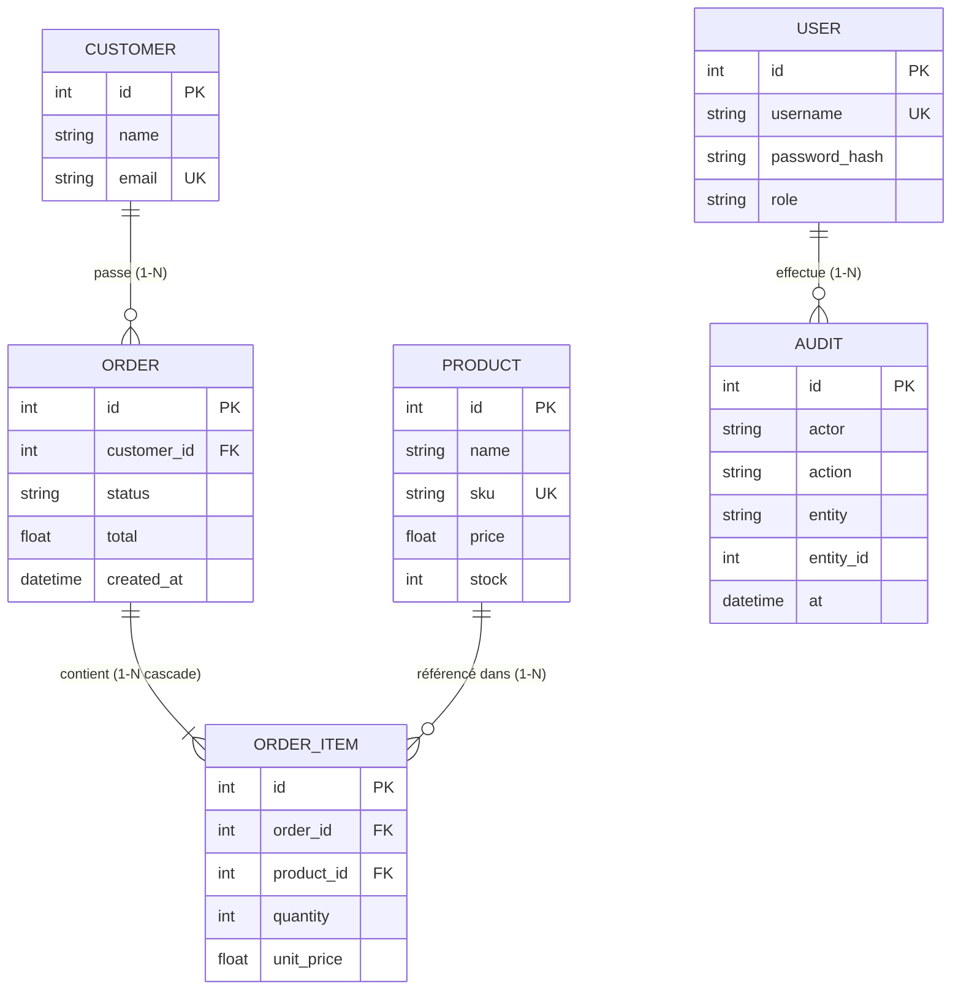
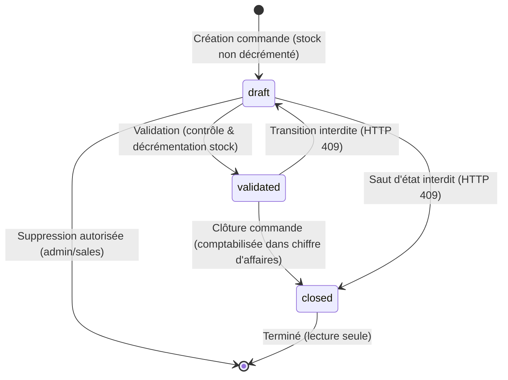

# Architecture et Conception Technique du Projet StockFlow

## 1. Présentation Générale

StockFlow est une application web complète de gestion commerciale et d'inventaire, conçue selon les principes de l'architecture en couches et conforme aux exigences de qualité de la norme **ISO/IEC 25010**.

L'application assure la traçabilité des opérations de vente, le suivi précis des stocks, l'application de règles métier strictes et la séparation des responsabilités à travers trois profils d'utilisateurs distincts.

---

## 2. Découpage en Couches et Choix Technologiques

| Couche | Technologie Retenue | Justification Technique (selon Cahier des Charges) |
|---|---|---|
| **Présentation (Frontend)** | Angular 19.2 (TypeScript, Signals, Standalone Components) | Framework robuste et typé garantissant la réactivité de l'interface, une gestion prédictible des états grâce aux Signals et une maintenabilité élevée. |
| **Services & API (Backend)** | Python 3.12, FastAPI 0.115.12, Pydantic 2.10.6 | Framework moderne asynchrone offrant une validation stricte des données à l'entrée par schémas Pydantic et une génération automatique de la documentation OpenAPI (`/docs`). |
| **Accès aux Données & BDD** | SQLAlchemy 2.0 (ORM), SQLite (embarqué) | Abstraction complète du stockage relationnel assurant l'intégrité référentielle, les transactions ACID (rollback automatique en cas d'erreur) et la portabilité sans serveur lourd externe. |
| **Sécurité & Authentification** | JWT (JSON Web Tokens), Bcrypt (`passlib`) | Gestion de sessions stateless sécurisées avec expiration à 2 heures, hachage robuste des mots de passe et contrôle d'accès granulaire par décorateurs (`Depends`). |
| **Conteneurisation & Déploiement** | Docker, Docker Compose | Déploiement reproductible et isolé sur tout environnement d'évaluation, garantissant la portabilité sans dépendance préalable de machine hôte. |

---

## 3. Modèle de Données et Relations

Le schéma de base de données comprend 4 entités métier interconnectées, plus une table d'audit et une table des comptes utilisateurs :

### Règles Relationnelles et Intégrité :
- **Customer → Order (1-N) :** Un client peut posséder plusieurs commandes. La suppression d'un client possédant des commandes est formellement bloquée (HTTP 409).
- **Order → OrderItem (1-N) :** Une commande contient au moins une ligne d'article lors de sa création. Les lignes sont supprimées en cascade lors de la suppression d'une commande brouillon.
- **Product → OrderItem (1-N) :** Un produit peut figurer dans de multiples commandes (relation N-N matérialisée entre `Order` et `Product`). La suppression d'un produit référencé dans une commande est rejetée (HTTP 409).

---

## 4. Matrice des Rôles et Autorisations (RBAC)

La sécurité est contrôlée au niveau du backend via la dépendance `require(*roles)` et reflétée dynamiquement dans le frontend :

| Fonctionnalité / Endpoint | Méthode HTTP | Administrateur (`admin`) | Commercial (`sales`) | Lecteur (`viewer`) |
|---|---|:---:|:---:|:---:|
| Consultation Dashboard & KPIs | `GET /api/dashboard` | **Autorisé** | **Autorisé** | **Autorisé** |
| Recherche / Lecture Clients & Produits | `GET /api/customers`, `/api/products` | **Autorisé** | **Autorisé** | **Autorisé** |
| Consultation Commandes | `GET /api/orders`, `/api/orders/{id}` | **Autorisé** | **Autorisé** | **Autorisé** |
| Création / Mise à jour Client | `POST`, `PUT /api/customers` | **Autorisé** | **Autorisé** | *Refusé (403)* |
| Suppression Client | `DELETE /api/customers/{id}` | **Autorisé** | *Refusé (403)* | *Refusé (403)* |
| Création / Mise à jour Produit | `POST`, `PUT /api/products` | **Autorisé** | **Autorisé** | *Refusé (403)* |
| Suppression Produit | `DELETE /api/products/{id}` | **Autorisé** | *Refusé (403)* | *Refusé (403)* |
| Création Commande Brouillon | `POST /api/orders` | **Autorisé** | **Autorisé** | *Refusé (403)* |
| Gestion des Lignes de Commande (Ajout/Suppr.) | `POST /orders/{id}/items`, `DELETE /order-items/{id}` | **Autorisé** | **Autorisé** | *Refusé (403)* |
| Transition de Statut (`validated`, `closed`) | `PATCH /api/orders/{id}/status` | **Autorisé** | **Autorisé** | *Refusé (403)* |
| Suppression Commande Brouillon | `DELETE /api/orders/{id}` | **Autorisé** | **Autorisé** | *Refusé (403)* |
| Consultation Journal d'Audit | `GET /api/audit` | **Autorisé** | *Refusé (403)* | *Refusé (403)* |

---

## 5. Workflow Métier à Statuts

Le cycle de vie d'une commande respecte un automate d'états strict :

1. **État Brouillon (`draft`) :** La commande est initialisée avec son client et ses lignes. Aucun stock n'est débité. L'ajout, la modification de lignes et la suppression de la commande sont permis.
2. **État Validé (`validated`) :** La transition vérifie la disponibilité de chaque produit. Si le stock est suffisant, la quantité commandée est déduite du stock disponible. Les lignes de commande deviennent alors verrouillées.
3. **État Clôturé (`closed`) :** La commande est archivée et son montant total est intégré dans le calcul du chiffre d'affaires clôturé du tableau de bord. Aucune modification ultérieure n'est acceptée.

---

## 6. Journal d'Audit et Traçabilité

Toute opération sensible modifiant l'état du système génère un enregistrement immédiat dans la table `Audit` :
- **Acteur (`actor`) :** Le nom d'utilisateur extrait du token JWT authentifié.
- **Action (`action`) :** `create`, `update`, `delete`, `transition`.
- **Entité (`entity`) :** `customer`, `product`, `order`, `order_item`.
- **Identifiant Entité (`entity_id`) :** L'ID de l'objet concerné.
- **Horodatage (`at`) :** Date et heure UTC précises de l'événement.
- **Restriction d'accès :** La consultation du journal est réservée au rôle `admin`. Tout accès par `sales` ou `viewer` est rejeté avec un code HTTP 403 Forbidden.
